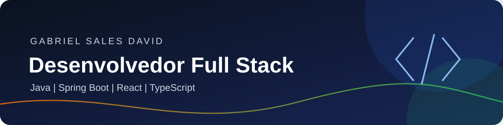
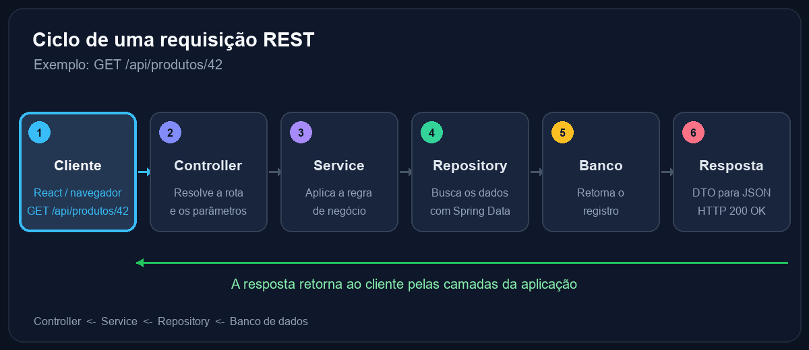
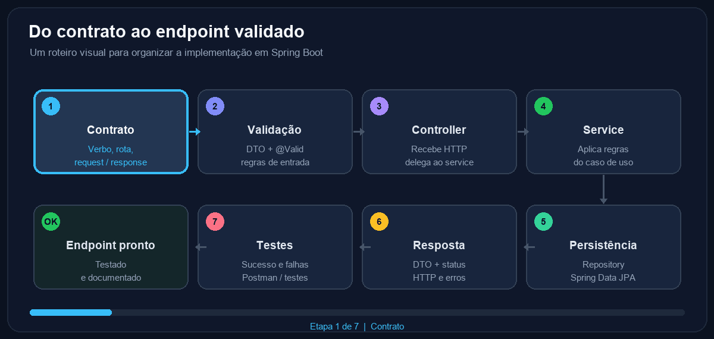
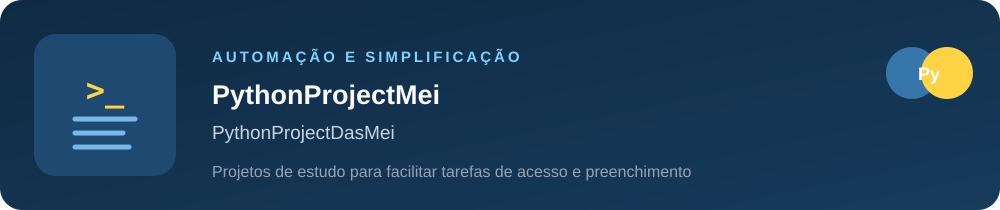

<div align="center">
  
</div>

<div align="center">

Construo APIs e interfaces web com foco em clareza, segurança, manutenção e valor para as pessoas.

<a href="https://linkedin.com/in/gabriel-s-java-python-csharp-sql"></a>
<a href="https://github.com/gabrielsalesdavid"></a>

</div>

---

## Sobre mim

Gosto de transformar necessidades em funcionalidades completas, da modelagem da API à interface que as pessoas utilizam.

## Competências técnicas

| Área | Tecnologias e práticas |
| :--- | :--- |
| **Backend** | Spring Security, Spring Data JPA, Maven e Gradle |
| **APIs e segurança** | REST, DTOs, validação, tratamento centralizado de erros, OAuth2 e JWT |
| **Frontend** | JavaScript, HTML5, CSS3, Tailwind CSS e Axios |
| **Dados** | MySQL e H2 para testes |
| **Testes e qualidade** | Testes de software, Cypress, Postman e código organizado para manutenção |
| **Entrega e ferramentas** | Git, CI/CD, Railway e Heroku |
| **Outros estudos** | C#, C, Delphi e SQL |

<div align="center">


</div>

## Exemplo de API Spring Boot

<div align="center">
  
</div>

### Exemplo de resposta JSON

```json
{
  "id": 42,
  "nome": "Teclado",
  "preco": 199.9
}
```

### Controller

```java
import org.springframework.http.ResponseEntity;
import org.springframework.web.bind.annotation.GetMapping;
import org.springframework.web.bind.annotation.PathVariable;
import org.springframework.web.bind.annotation.RequestMapping;
import org.springframework.web.bind.annotation.RestController;

@RestController
@RequestMapping("/api/produtos")
public class ProdutoController {
    private final ProdutoService service;

    public ProdutoController(ProdutoService service) {
        this.service = service;
    }

    @GetMapping("/{id}")
    public ResponseEntity<ProdutoResponse> buscar(@PathVariable Long id) {
        return ResponseEntity.ok(service.buscarPorId(id));
    }
}
```

## Repositórios públicos

> Organizei os repositórios pela linguagem e pelo objetivo observado no código ou na documentação. Projetos sem documentação suficiente estão identificados como tal.

### Java

<div align="center">
  
</div>

#### Spring Boot, APIs e aplicações

- [Project-Spring-Gradle-Dio](https://github.com/gabrielsalesdavid/Project-Spring-Gradle-Dio) — Aplicação de estudo em Spring Boot e Gradle, com arquitetura em camadas e exemplos de boas práticas em Java e Kotlin.
- [Project-Web-Security-Dio](https://github.com/gabrielsalesdavid/Project-Web-Security-Dio) — Exercícios de segurança web com Spring Boot, acompanhados de material sobre autenticação e autorização.
- [Project-Spring-Web-Data-Dio](https://github.com/gabrielsalesdavid/Project-Spring-Web-Data-Dio) — API Spring Boot para cadastro e gerenciamento de clientes e endereços.
- [Project-Spring-Web-API-Swagger-Dio](https://github.com/gabrielsalesdavid/Project-Spring-Web-API-Swagger-Dio) — API REST em Spring Boot com documentação Swagger.
- [Project-Spring-JPA-Data-Dio](https://github.com/gabrielsalesdavid/Project-Spring-JPA-Data-Dio) — CRUD de usuários com Spring Data JPA, Hibernate e PostgreSQL.
- [Porject-Spring-Maven-Java-With-Lombok-Dio](https://github.com/gabrielsalesdavid/Porject-Spring-Maven-Java-With-Lombok-Dio) — Projeto educacional de Spring Boot com Maven e Lombok.
- [Project-Gradle-Java-Lombok-With-Kotlin](https://github.com/gabrielsalesdavid/Project-Gradle-Java-Lombok-With-Kotlin) — Estudos de Java e Kotlin com Gradle, Lombok e padrão Builder.
- [PROJECT-MAVEN-JAVA-WITH-LOMBOK](https://github.com/gabrielsalesdavid/PROJECT-MAVEN-JAVA-WITH-LOMBOK) — Projeto de curso para praticar Java, Maven e Lombok.
- [PROJECT-GRADLE-BOARD](https://github.com/gabrielsalesdavid/PROJECT-GRADLE-BOARD) — Aplicação de gerenciamento de tarefas no estilo Kanban, feita com Java, Kotlin e persistência SQL.
- [Project-Gradle-Java-With-Lombok](https://github.com/gabrielsalesdavid/Project-Gradle-Java-With-Lombok) — Exemplo de projeto Java com Gradle, Lombok e MapStruct.
- [DioMe-Avanade-Spring-Boot](https://github.com/gabrielsalesdavid/DioMe-Avanade-Spring-Boot) — API REST de gerenciamento de livros, desenvolvida como exercício de Spring Boot.
- [DevSuperior-Intesivao-Java-Spring](https://github.com/gabrielsalesdavid/DevSuperior-Intesivao-Java-Spring) — Projeto e anotações do curso Intensivão Java Spring da DevSuperior.
- [RocketSeat-NLW-Unite](https://github.com/gabrielsalesdavid/RocketSeat-NLW-Unite) — Backend Pass.In para eventos, participantes e registro de check-in, desenvolvido com Spring Boot.
- [RocketSeat-NLW-Journey](https://github.com/gabrielsalesdavid/RocketSeat-NLW-Journey) — Aplicação para planejar viagens, participantes, atividades e links úteis.

<div align="center">
  
  
</div>

#### Fundamentos, orientação a objetos e exercícios

- [Dio-Everis-New-Talents](https://github.com/gabrielsalesdavid/Dio-Everis-New-Talents) — Exercícios introdutórios de Java sobre tipos, valores padrão e classes.
- [Estrutura-de-Dados-em-Java_Loiane_Groner](https://github.com/gabrielsalesdavid/Estrutura-de-Dados-em-Java_Loiane_Groner) — Implementações didáticas de vetores, estruturas genéricas, pilhas, filas e fila prioritária.
- [Desafio-Dio-Inter-Java-POO](https://github.com/gabrielsalesdavid/Desafio-Dio-Inter-Java-POO) — Modelo de bootcamp em Java com cursos, mentorias, conteúdos e desenvolvedores inscritos.
- [Dio-Project-Inter](https://github.com/gabrielsalesdavid/Dio-Project-Inter) — Exercícios de lógica e fundamentos Java, como matrizes, cálculos, condicionais e laços.
- [DESAFIO-DIO-BANK](https://github.com/gabrielsalesdavid/DESAFIO-DIO-BANK) — Simulação de operações bancárias para praticar orientação a objetos.
- [DioMe-Bradesco](https://github.com/gabrielsalesdavid/DioMe-Bradesco) — Coleção de projetos e exercícios de Java do bootcamp DIO/Bradesco.
- [DioMe-Fundamentos-Java](https://github.com/gabrielsalesdavid/DioMe-Fundamentos-Java) — Material e exercícios de fundamentos da linguagem Java.
- [DioMe-Conta-Banco-Project](https://github.com/gabrielsalesdavid/DioMe-Conta-Banco-Project) — Exercício de modelagem de cliente e conta bancária em Java.
- [Udemy-Nelio-Alves-Java-Completo-2023-Poo-Proje](https://github.com/gabrielsalesdavid/Udemy-Nelio-Alves-Java-Completo-2023-Poo-Proje) — Exercícios do curso de Java, incluindo classes, encapsulamento e generics.
- [DioMe-Bradesco-Desafio](https://github.com/gabrielsalesdavid/DioMe-Bradesco-Desafio) — Desafio Java com validação de parâmetros e tratamento de exceções.
- [DioMe-Jogo-Sudoku](https://github.com/gabrielsalesdavid/DioMe-Jogo-Sudoku) — Jogo de Sudoku com tabuleiro, regras e interface de interação.
- [DevSuperior-Linguagem-Java](https://github.com/gabrielsalesdavid/DevSuperior-Linguagem-Java) — Exemplos e exercícios de programação Java da DevSuperior.
- [DevSuperior-Java](https://github.com/gabrielsalesdavid/DevSuperior-Java) — Repositório de estudos de Java; o README atual não detalha o conteúdo.

### JavaScript

#### Fundamentos e aplicações

- [Origamid-JavaScript-Completo-ES6](https://github.com/gabrielsalesdavid/Origamid-JavaScript-Completo-ES6) — Aulas e exercícios de JavaScript ES6 e manipulação do DOM, com exemplos em HTML e CSS.
- [JavaScript-Fernanda-Kipper](https://github.com/gabrielsalesdavid/JavaScript-Fernanda-Kipper) — Material introdutório de JavaScript e HTML, com exemplos comentados em português.
- [DevSuperior-Nivelamento-JavaScript](https://github.com/gabrielsalesdavid/DevSuperior-Nivelamento-JavaScript) — Exercícios e pequenos projetos para nivelamento em JavaScript.
- [Descomplica](https://github.com/gabrielsalesdavid/Descomplica) — Atividade introdutória com exercícios de funções em JavaScript.

#### Estruturas de dados e testes

- [DevSuperior-Estrutura-De-Dados](https://github.com/gabrielsalesdavid/DevSuperior-Estrutura-De-Dados) — Exercícios de estruturas de dados e algoritmos em JavaScript puro.
- [Alura-Cypress-Automatizando-Testes-E2E](https://github.com/gabrielsalesdavid/Alura-Cypress-Automatizando-Testes-E2E) — Testes automatizados E2E com Cypress para uma aplicação de adoção de animais.

### Python

<div align="center">
  
</div>

#### Aplicações para MEI

- [PythonProjectMei](https://github.com/gabrielsalesdavid/PythonProjectMei) — Aplicação Streamlit para orientar microempreendedores no acesso e preenchimento relacionado ao DAS do Simples Nacional.
- [PythonProjectDasMei](https://github.com/gabrielsalesdavid/PythonProjectDasMei) — Aplicação Streamlit de apoio a tarefas do DAS-MEI, acompanhada de material de estudo sobre Python.

#### Fundamentos, algoritmos e estudos

- [Algoritmos-E-Estruturas-De-Dados-Linux_Tips](https://github.com/gabrielsalesdavid/Algoritmos-E-Estruturas-De-Dados-Linux_Tips) — Estudos práticos de Python, algoritmos e estruturas de dados, com exemplos comentados.
- [DevSuperior-Linguagem-Python](https://github.com/gabrielsalesdavid/DevSuperior-Linguagem-Python) — Fundamentos e exemplos de programação em Python da DevSuperior.
- [Alura-Itensivo-Python](https://github.com/gabrielsalesdavid/Alura-Itensivo-Python) — Exercícios e exemplos práticos do curso de Python da Alura.
- [Testes-Linkedin](https://github.com/gabrielsalesdavid/Testes-Linkedin) — Script pessoal em Python relacionado a quizzes do LinkedIn; o repositório não possui documentação técnica detalhada.

### C#

- [DevSuperior-Linguagem-em-C-Sharp](https://github.com/gabrielsalesdavid/DevSuperior-Linguagem-em-C-Sharp) — Exemplos e exercícios introdutórios de C# da DevSuperior.
- [DevSuperior-C-Sharp](https://github.com/gabrielsalesdavid/DevSuperior-C-Sharp) — Material de estudo e exercícios de C# e orientação a objetos.
- [RocketSeat-NLW-Expert](https://github.com/gabrielsalesdavid/RocketSeat-NLW-Expert) — API REST de leilões desenvolvida em C# e .NET 8 durante o NLW Expert.

### C

- [DevSuperior-Linguagem-C](https://github.com/gabrielsalesdavid/DevSuperior-Linguagem-C) — Exemplos e exercícios de programação em C.

### C++

- [DevSuperior-Linguagem-C-PP](https://github.com/gabrielsalesdavid/DevSuperior-Linguagem-C-PP) — Exercícios de C++, incluindo conceitos de orientação a objetos.

### HTML e CSS

- [DevSuperior-GitHub](https://github.com/gabrielsalesdavid/DevSuperior-GitHub) — Estudos de fundamentos de programação web.
- [DevSuperior-Nivelamento-HTML-CSS](https://github.com/gabrielsalesdavid/DevSuperior-Nivelamento-HTML-CSS) — Exercícios de HTML5 e CSS3 com foco em interfaces responsivas.

### SQL e bancos de dados

- [DevSuperiorSQL-DDL-DML](https://github.com/gabrielsalesdavid/DevSuperiorSQL-DDL-DML) — Material de estudo sobre comandos SQL de definição e manipulação de dados (DDL e DML).
- [DevSuperior-Consultas-em-SQL](https://github.com/gabrielsalesdavid/DevSuperior-Consultas-em-SQL) — Consultas, scripts e exercícios de SQL.
- [DevSuperior-Banco-de-Dados-SQL](https://github.com/gabrielsalesdavid/DevSuperior-Banco-de-Dados-SQL) — Material de aprendizado sobre bancos de dados relacionais e SQL.

### Lógica de programação

- [DevSuperior-Logica-de-Programacao-e-Algoritmo](https://github.com/gabrielsalesdavid/DevSuperior-Logica-de-Programacao-e-Algoritmo) — Exemplos e exercícios de lógica e algoritmos em Portugol/VisualG.

### Git e GitHub

- [DevSuperior-Desafio-Git-Reset](https://github.com/gabrielsalesdavid/DevSuperior-Desafio-Git-Reset) — Exercício de versionamento para praticar operações de reset no Git.
- [DevSuperior-Desafio-Git-Merge](https://github.com/gabrielsalesdavid/DevSuperior-Desafio-Git-Merge) — Exercício de Git com foco em merge e resolução de conflitos.

### Cloud e Azure

<div align="center">
  
</div>

- [Resumo-do-Lab-Dio](https://github.com/gabrielsalesdavid/Resumo-do-Lab-Dio) — Material de estudo sobre computação em nuvem, modelos de serviço, implementação e custos.
- [Dio-Lab-Azure](https://github.com/gabrielsalesdavid/Dio-Lab-Azure) — Guia ilustrado para criar e conectar uma máquina virtual no Microsoft Azure.
- [Dio-Lab-Azure-BD](https://github.com/gabrielsalesdavid/Dio-Lab-Azure-BD) — Passo a passo de criação e conexão a um banco de dados SQL no Azure.
- [Project-Azure-IA-Dio](https://github.com/gabrielsalesdavid/Project-Azure-IA-Dio) — Documentação de estudo dos serviços Azure AI, incluindo Speech, Language e Vision.

### Delphi

- [Delphi-Sistema-Clinica](https://github.com/gabrielsalesdavid/Delphi-Sistema-Clinica) — Projeto de sistema para clínica em Delphi; o README atual não descreve suas funcionalidades.
- [Delphi-Agenda](https://github.com/gabrielsalesdavid/Delphi-Agenda) — Projeto de agenda em Delphi; consulte o código do repositório para conhecer o escopo atual.

### Ambiente de desenvolvimento integrado

- [Challenge](https://github.com/gabrielsalesdavid/Challenge) — Arquivos de orquestração de um ambiente local para o HypeSoft ShopSense, com serviços de frontend, API, MongoDB, Keycloak e Nginx, além de scripts de verificação.

### Projeto visual relacionado a MEI/DAS

- [Das-Mei](https://github.com/gabrielsalesdavid/Das-Mei) — Repositório relacionado ao DAS-MEI com artefatos de uma plataforma visual; não há README funcional que permita detalhar o fluxo com segurança.

### Modelagem UML

- [DioME-UML](https://github.com/gabrielsalesdavid/DioME-UML) — Repositório com tema UML; atualmente contém apenas uma classe Java inicial, sem diagramas ou funcionalidades documentadas.

### Configuração do perfil

- [gabrielsalesdavid](https://github.com/gabrielsalesdavid/gabrielsalesdavid) — Arquivos de configuração e conteúdo deste perfil do GitHub.

<!-- repos-start -->

<!-- repos-end -->

Aberto a conversar sobre oportunidades, entrevistas técnicas e projetos de desenvolvimento.

<a href="mailto:gabrielsalesdavid@hotmail.com"></a>
