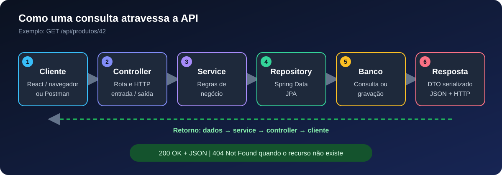

<div align="center">
  
</div>

<div align="center">

# Gabriel Sales David

### Desenvolvedor Full Stack Jr. | Java, Spring Boot e React

Construo APIs e interfaces web com foco em clareza, segurança, manutenção e valor para as pessoas.

<a href="https://linkedin.com/in/gabriel-s-java-python-csharp-sql"></a>
<a href="https://github.com/gabrielsalesdavid"></a>

</div>

---

## Sobre mim

Sou desenvolvedor Full Stack com foco principal em **Backend Java e Spring Boot**, complementado por experiência em **React e TypeScript**. Gosto de transformar necessidades em funcionalidades completas, da modelagem da API à interface que as pessoas utilizam.

Tenho estudado e aplicado conceitos como arquitetura em camadas, APIs REST, persistência com JPA, autenticação e autorização, testes e integração com serviços externos. Também mantenho projetos de estudo em Python, JavaScript, SQL, C#, C, Delphi e Azure.

## Competências técnicas

| Área | Tecnologias e práticas |
| :--- | :--- |
| **Backend** | Java 17+, Spring Boot, Spring Security, Spring Data JPA, Maven e Gradle |
| **APIs e segurança** | REST, DTOs, validação, tratamento centralizado de erros, OAuth2 e JWT |
| **Frontend** | React, TypeScript, JavaScript, HTML5, CSS3, Tailwind CSS e Axios |
| **Dados** | PostgreSQL, MySQL e H2 para testes |
| **Testes e qualidade** | Testes de software, Cypress, Postman e código organizado para manutenção |
| **Entrega e ferramentas** | Docker, Git, CI/CD, Railway e Heroku |
| **Outros estudos** | Python, C#, C, Delphi, SQL e Microsoft Azure |

<div align="center">


</div>

## Como trabalho

- **Organização:** separação de responsabilidades em camadas e uso de DTOs para contratos mais claros.
- **APIs:** endpoints REST com validação, persistência e respostas de erro consistentes.
- **Segurança:** estudos e implementações com autenticação, autorização, OAuth2 e JWT.
- **Persistência:** mapeamento e acesso a dados com JPA, usando bancos relacionais conforme o contexto.
- **Qualidade:** testes e verificações com ferramentas como Cypress e Postman.
- **Entrega:** versionamento com Git e contato com Docker e pipelines de CI/CD.
- **Experiência web:** interfaces React com TypeScript, componentes reutilizáveis e integração HTTP.

## Exemplo técnico: ciclo de uma requisição REST

Este fluxo ilustra como uma consulta de produto pode percorrer as camadas de uma API Spring Boot. A animação destaca cada etapa; o diagrama estático logo abaixo apresenta o mesmo caminho sem movimento.

<div align="center">
  
</div>

<details>
  <summary>Ver o diagrama estático</summary>
  <br />
  
</details>

### O que acontece em cada etapa

1. **Cliente:** navegador, aplicação React ou Postman envia `GET /api/produtos/42`.
2. **Controller:** Spring MVC associa a URL ao endpoint, converte o parâmetro e encaminha a solicitação.
3. **Service:** aplica as regras de negócio e solicita os dados necessários.
4. **Repository:** Spring Data JPA consulta a persistência sem expor SQL ao controller.
5. **Banco de dados:** retorna o registro; a aplicação transforma o resultado em um DTO de resposta.
6. **Resposta HTTP:** o controller devolve JSON e um status adequado, por exemplo `200 OK`; se o produto não existir, pode responder `404 Not Found`.

O caminho de retorno percorre as camadas de volta até o cliente. A separação evita concentrar regras de negócio, acesso a dados e detalhes HTTP em um único componente.

### Exemplo de contrato

```http
GET /api/produtos/42
Accept: application/json
```

Uma resposta possível:

```json
{
  "id": 42,
  "nome": "Teclado",
  "preco": 199.9
}
```

### Exemplo simplificado em Spring Boot

O trecho abaixo é ilustrativo: controller recebe a requisição, delega ao service e retorna um DTO. O tratamento de ausência pode ser feito por uma exceção de domínio mapeada para `404`, por exemplo com `@ControllerAdvice`.

```java
import org.springframework.http.ResponseEntity;
import org.springframework.web.bind.annotation.GetMapping;
import org.springframework.web.bind.annotation.PathVariable;
import org.springframework.web.bind.annotation.RequestMapping;
import org.springframework.web.bind.annotation.RestController;

@RestController
@RequestMapping("/api/produtos")
public class ProdutoController {
    private final ProdutoService service;

    public ProdutoController(ProdutoService service) {
        this.service = service;
    }

    @GetMapping("/{id}")
    public ResponseEntity<ProdutoResponse> buscar(@PathVariable Long id) {
        return ResponseEntity.ok(service.buscarPorId(id));
    }
}
```

## Passo a passo para implementar e validar um endpoint

1. **Definir o recurso e o contrato:** decidir rota, método HTTP, campos recebidos e estrutura da resposta.
2. **Validar a entrada:** criar DTOs e restrições, como `@NotBlank` e `@Positive`, quando aplicável.
3. **Implementar o caso de uso:** manter regras no service e deixar o controller responsável pela borda HTTP.
4. **Persistir os dados:** modelar entidade e repositório, escolhendo consultas apropriadas para o caso.
5. **Mapear os resultados:** converter entidades em DTOs e traduzir erros para status HTTP claros.
6. **Testar cenários:** verificar sucesso, entrada inválida, recurso inexistente e acesso não autorizado, se houver autenticação.
7. **Documentar e exercitar:** publicar o contrato com Swagger/OpenAPI e conferir chamadas com Postman ou testes automatizados.

## Projetos em destaque

### Aplicações Python

- [PythonProjectMei](https://github.com/gabrielsalesdavid/PythonProjectMei) — ferramenta para facilitar o acesso ao sistema do Simples Nacional e o preenchimento das informações.
- [PythonProjectDasMei](https://github.com/gabrielsalesdavid/PythonProjectDasMei) — aplicação criada para simplificar o acesso ao sistema relacionado ao DAS.

### Java e Spring

- [Project-Spring-Web-API-Swagger-Dio](https://github.com/gabrielsalesdavid/Project-Spring-Web-API-Swagger-Dio) — projeto de estudo com Java, Spring Web, APIs e Swagger.
- [Project-Web-Security-Dio](https://github.com/gabrielsalesdavid/Project-Web-Security-Dio) — projeto de estudo voltado à segurança web no ecossistema Java.
- [Project-Spring-JPA-Data-Dio](https://github.com/gabrielsalesdavid/Project-Spring-JPA-Data-Dio) — exercício com Spring Data JPA e persistência.

### Cloud e Azure

- [Dio-Lab-Azure](https://github.com/gabrielsalesdavid/Dio-Lab-Azure) — anotações e experimentos de aprendizado sobre Microsoft Azure.
- [Project-Azure-IA-Dio](https://github.com/gabrielsalesdavid/Project-Azure-IA-Dio) — repositório de estudo relacionado a Azure e inteligência artificial.

> Os projetos acima incluem estudos e exercícios de cursos; consulte cada repositório para ver o escopo, tecnologias e estado atuais.

## Repositórios públicos

> Lista atualizada automaticamente com os repositórios públicos da conta.

<!-- repos-start -->
- [gabrielsalesdavid](https://github.com/gabrielsalesdavid/gabrielsalesdavid) — Config files for my GitHub profile.
- [Origamid-JavaScript-Completo-ES6](https://github.com/gabrielsalesdavid/Origamid-JavaScript-Completo-ES6)
- [Algoritmos-E-Estruturas-De-Dados-Linux_Tips](https://github.com/gabrielsalesdavid/Algoritmos-E-Estruturas-De-Dados-Linux_Tips)
- [JavaScript-Fernanda-Kipper](https://github.com/gabrielsalesdavid/JavaScript-Fernanda-Kipper)
- [Dio-Everis-New-Talents](https://github.com/gabrielsalesdavid/Dio-Everis-New-Talents)
- [Estrutura-de-Dados-em-Java_Loiane_Groner](https://github.com/gabrielsalesdavid/Estrutura-de-Dados-em-Java_Loiane_Groner)
- [Das-Mei](https://github.com/gabrielsalesdavid/Das-Mei)
- [Desafio-Dio-Inter-Java-POO](https://github.com/gabrielsalesdavid/Desafio-Dio-Inter-Java-POO)
- [Dio-Project-Inter](https://github.com/gabrielsalesdavid/Dio-Project-Inter)
- [Resumo-do-Lab-Dio](https://github.com/gabrielsalesdavid/Resumo-do-Lab-Dio) — Este repositório consiste numa breve apresentação sobre Cloud. Trago consigo um resmo e os detalhes do serviço.
- [Project-Azure-IA-Dio](https://github.com/gabrielsalesdavid/Project-Azure-IA-Dio)
- [Dio-Lab-Azure](https://github.com/gabrielsalesdavid/Dio-Lab-Azure) — Este repositório é focado na experiencia sobre o uso do Azure!
- [Dio-Lab-Azure-BD](https://github.com/gabrielsalesdavid/Dio-Lab-Azure-BD)
- [PythonProjectMei](https://github.com/gabrielsalesdavid/PythonProjectMei) — Desenvolvi uma forma mais simples para que o Usuário consiga acessar o sistema do Simples Nacional. É algo bem básico que, creio eu possa facilitar as pessoas no preenchimento do campo e na navegação entre as paginas.
- [PythonProjectDasMei](https://github.com/gabrielsalesdavid/PythonProjectDasMei) — Desenvolvi uma aplicação para facilitar a vida de pessoas que possui uma certa dificuldade em acessar o sistema de acordo do DAS
- [Project-Spring-Gradle-Dio](https://github.com/gabrielsalesdavid/Project-Spring-Gradle-Dio)
- [Project-Web-Security-Dio](https://github.com/gabrielsalesdavid/Project-Web-Security-Dio)
- [Project-Spring-Web-Data-Dio](https://github.com/gabrielsalesdavid/Project-Spring-Web-Data-Dio)
- [Project-Spring-Web-API-Swagger-Dio](https://github.com/gabrielsalesdavid/Project-Spring-Web-API-Swagger-Dio)
- [Project-Spring-JPA-Data-Dio](https://github.com/gabrielsalesdavid/Project-Spring-JPA-Data-Dio)
- [Porject-Spring-Maven-Java-With-Lombok-Dio](https://github.com/gabrielsalesdavid/Porject-Spring-Maven-Java-With-Lombok-Dio)
- [Project-Gradle-Java-Lombok-With-Kotlin](https://github.com/gabrielsalesdavid/Project-Gradle-Java-Lombok-With-Kotlin)
- [DESAFIO-DIO-BANK](https://github.com/gabrielsalesdavid/DESAFIO-DIO-BANK)
- [DioMe-Bradesco](https://github.com/gabrielsalesdavid/DioMe-Bradesco)
- [DevSuperior-Nivelamento-JavaScript](https://github.com/gabrielsalesdavid/DevSuperior-Nivelamento-JavaScript)
- [Challenge](https://github.com/gabrielsalesdavid/Challenge)
- [DioMe-Fundamentos-Java](https://github.com/gabrielsalesdavid/DioMe-Fundamentos-Java)
- [PROJECT-MAVEN-JAVA-WITH-LOMBOK](https://github.com/gabrielsalesdavid/PROJECT-MAVEN-JAVA-WITH-LOMBOK)
- [PROJECT-GRADLE-BOARD](https://github.com/gabrielsalesdavid/PROJECT-GRADLE-BOARD)
- [Project-Gradle-Java-With-Lombok](https://github.com/gabrielsalesdavid/Project-Gradle-Java-With-Lombok)
- [DevSuperior-GitHub](https://github.com/gabrielsalesdavid/DevSuperior-GitHub)
- [DevSuperior-Linguagem-C](https://github.com/gabrielsalesdavid/DevSuperior-Linguagem-C)
- [RocketSeat-NLW-Unite](https://github.com/gabrielsalesdavid/RocketSeat-NLW-Unite)
- [RocketSeat-NLW-Journey](https://github.com/gabrielsalesdavid/RocketSeat-NLW-Journey)
- [DevSuperior-Linguagem-em-C-Sharp](https://github.com/gabrielsalesdavid/DevSuperior-Linguagem-em-C-Sharp)
- [DevSuperior-Linguagem-Python](https://github.com/gabrielsalesdavid/DevSuperior-Linguagem-Python)
- [DevSuperiorSQL-DDL-DML](https://github.com/gabrielsalesdavid/DevSuperiorSQL-DDL-DML)
- [DevSuperior-Consultas-em-SQL](https://github.com/gabrielsalesdavid/DevSuperior-Consultas-em-SQL)
- [DevSuperior-Desafio-Git-Reset](https://github.com/gabrielsalesdavid/DevSuperior-Desafio-Git-Reset)
- [DevSuperior-Linguagem-C-PP](https://github.com/gabrielsalesdavid/DevSuperior-Linguagem-C-PP)
- [DioMe-Avanade-Spring-Boot](https://github.com/gabrielsalesdavid/DioMe-Avanade-Spring-Boot)
- [DioMe-Conta-Banco-Project](https://github.com/gabrielsalesdavid/DioMe-Conta-Banco-Project)
- [DevSuperior-Java](https://github.com/gabrielsalesdavid/DevSuperior-Java)
- [Testes-Linkedin](https://github.com/gabrielsalesdavid/Testes-Linkedin) — Faço testes de QUIZ que aparece na minha timeline do linke... Caso aja duvida sobre o resultado ou ate mesmo para compreende-lo!
- [Udemy-Nelio-Alves-Java-Completo-2023-Poo-Proje](https://github.com/gabrielsalesdavid/Udemy-Nelio-Alves-Java-Completo-2023-Poo-Proje)
- [DioMe-Bradesco-Desafio](https://github.com/gabrielsalesdavid/DioMe-Bradesco-Desafio)
- [DioMe-Jogo-Sudoku](https://github.com/gabrielsalesdavid/DioMe-Jogo-Sudoku)
- [DevSuperior-Banco-de-Dados-SQL](https://github.com/gabrielsalesdavid/DevSuperior-Banco-de-Dados-SQL)
- [DevSuperior-Desafio-Git-Merge](https://github.com/gabrielsalesdavid/DevSuperior-Desafio-Git-Merge)
- [DevSuperior-Linguagem-Java](https://github.com/gabrielsalesdavid/DevSuperior-Linguagem-Java)
- [DevSuperior-C-Sharp](https://github.com/gabrielsalesdavid/DevSuperior-C-Sharp)
- [DevSuperior-Logica-de-Programacao-e-Algoritmo](https://github.com/gabrielsalesdavid/DevSuperior-Logica-de-Programacao-e-Algoritmo)
- [DevSuperior-Estrutura-De-Dados](https://github.com/gabrielsalesdavid/DevSuperior-Estrutura-De-Dados)
- [DevSuperior-Intesivao-Java-Spring](https://github.com/gabrielsalesdavid/DevSuperior-Intesivao-Java-Spring)
- [Alura-Itensivo-Python](https://github.com/gabrielsalesdavid/Alura-Itensivo-Python)
- [RocketSeat-NLW-Expert](https://github.com/gabrielsalesdavid/RocketSeat-NLW-Expert)
- [DevSuperior-Nivelamento-HTML-CSS](https://github.com/gabrielsalesdavid/DevSuperior-Nivelamento-HTML-CSS)
- [Alura-Cypress-Automatizando-Testes-E2E](https://github.com/gabrielsalesdavid/Alura-Cypress-Automatizando-Testes-E2E)
- [Delphi-Sistema-Clinica](https://github.com/gabrielsalesdavid/Delphi-Sistema-Clinica)
- [Delphi-Agenda](https://github.com/gabrielsalesdavid/Delphi-Agenda)
- [Descomplica](https://github.com/gabrielsalesdavid/Descomplica)
- [DioME-UML](https://github.com/gabrielsalesdavid/DioME-UML)
<!-- repos-end -->

## Contato

- **LinkedIn:** [gabriel-s-java-python-csharp-sql](https://linkedin.com/in/gabriel-s-java-python-csharp-sql)
- **Email:** [gabrielsalesdavid@hotmail.com](mailto:gabrielsalesdavid@hotmail.com)
- **GitHub:** [github.com/gabrielsalesdavid](https://github.com/gabrielsalesdavid)

Aberto a conversar sobre oportunidades, entrevistas técnicas e projetos de desenvolvimento.
